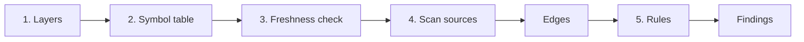

# How it works

A run has five steps: find the layers, load the symbol table, check it is fresh, scan the source
files, and apply the rules.

How long a run takes is on the [performance](./performance) page.

## 1. Layers

With the [Nuxt module](./nuxt-module), layers come from the registry it wrote: Nuxt's `_layers`
in priority order with the directories from `getLayerDirectories()`.

Without the module, layerscope loads the project's own `@nuxt/kit` (the one Nuxt installed, so
defaults match your Nuxt version) and calls `loadNuxtConfig()` and `getLayerDirectories()`. If
kit cannot be loaded, layers can still be declared with [`path`](../reference/config#layers) in
the config.

Layer names and ownership are described in [Layers](./layers).

## 2. The symbol table

The symbol table maps every name Nuxt auto-imports to where it comes from, per context:

- **components**: `BaseButton` and `LazyBaseButton` → `layers/shared/app/components/BaseButton.vue`.
  A name can map to more than one file, for example `Pair.client.vue` in one layer and
  `Pair.server.vue` in another layer.
- **app imports**: `useCart` → `layers/web/app/composables/useCart.ts`, `ref` → `vue`
- **server imports**: `useDb` → `layers/shared/server/utils/db.ts`, `defineEventHandler` → `h3`
- **shared imports**: what both app and server code can use

It comes from one of two sources:

| Source     | Read from                                                                                                                                                      |
| ---------- | -------------------------------------------------------------------------------------------------------------------------------------------------------------- |
| `registry` | `.nuxt/layerscope/registry.json`, written by the Nuxt module from Nuxt's hooks                                                                                 |
| `types`    | `.nuxt/components.d.ts` (or `.nuxt/types/components.d.ts`), `.nuxt/types/imports.d.ts`, `.nuxt/types/nitro-imports.d.ts` and `.nuxt/types/shared-imports.d.ts` |

By default the registry is used when it exists. Both produce the same boundary findings; the
registry also knows overridden components. On Nuxt 3, which writes no `shared-imports.d.ts`, the
`types` source gives shared code the imports that app and server have in common, which is the
rule Nuxt 4 uses.

## 3. Freshness

Generated files are only correct if they were written after the last change to your layers.
layerscope stops with exit code `2` when they are clearly stale:

- a component or auto-import points at a file that no longer exists, or
- a component file exists that Nuxt has not registered. With the registry, every component dir
  Nuxt scanned is compared with the files recorded when it was written, but a dir in
  `node_modules` is not checked; with the `types` source
  the default `components/` dirs are checked (overridden and island components are expected to be
  missing there), or
- an auto-import file exists that is not in the registry. An example is a composable that
  overrides one of a lower layer. The registry lists the dirs that Nuxt and Nitro scan for
  auto-imports: `composables/`, `utils/`, `shared/utils`, `shared/types`, `server/utils` and the
  `imports.dirs` of each layer. A dir in `node_modules` is not checked. A dir that you add in
  `nuxt.config` is checked after the next `nuxi prepare`. The `types` source does not check
  auto-import dirs.

With the registry, the check skips a new file that Nuxt ignores (`ignore`, `ignorePrefix` or
`.nuxtignore`) in a component dir and in an auto-import dir of the app. It does not skip such a
file in an auto-import dir of Nitro, such as `server/utils` and `shared/utils`, because Nitro
auto-imports it.

layerscope does not check a dir that does not exist (or that has a file in its path). That dir has
no new files. layerscope stops with exit code `2` when it cannot open a dir, for example because it
has no read access. It cannot look for new files in that dir. It also stops when it cannot reach a
file that the generated types refer to.

File modification times are not used: Nuxt skips rewriting unchanged files, so they would
report stale files that are not.

## 4. Scanning

Every source file of every checked layer is parsed:

- **Scripts** (`.ts`, `.js`, `.tsx`, `.jsx`, `.mts`, `.cts`, `.mjs`, `.cjs`, and `<script>` blocks
  of `.vue` files) are parsed with [oxc-parser](https://oxc.rs) and scope-tracked. An identifier
  that is not declared, imported or a known global is a _free_ identifier: it is auto-imported or
  unresolved. In a `.vue`, `.jsx` or `.tsx` file outside the `server/` dir, the first argument of
  `h()` is a component use when Nuxt registers a component with that name, also when a binding has
  that name. In the same files, a JSX tag that is not an HTML or SVG element, not `Fragment`, not a
  local binding and not a JavaScript global such as `Map` is a component use, as Vue's JSX plugin
  compiles it to `resolveComponent()`. A local `const useCart = ...` shadows the auto-import of the
  same name, just as it does at runtime.
- **Templates** are compiled with `@vue/compiler-sfc`, the compiler Vue uses. The render function
  shows which components Nuxt resolves (`resolveComponent("CartSummary")`) and which identifiers
  the template reads from the component instance (`_ctx.formatPrice`). It also shows an `import()`
  in the template, which layerscope reads as in a script. `<component :is>` bound to a runtime value
  cannot be resolved and is reported.
- **Imports** are resolved like the bundler does: relative paths, Nuxt's aliases (`~`, `@`,
  `#layers/...`, and your own, read from the generated `tsconfig`), `.js` → `.ts`, and
  `index` files. An import of a layer by its package name, or of a path in the layer,
  resolves to the file in that layer. When the `package.json` of the layer has `exports`, only the
  paths that `exports` gives a file for resolve. Other packages are not resolved: they are
  external. `#imports` and `#components` are resolved by name through the symbol table.

Each reference becomes an **edge**: from a file and its layer to a target file and its layer, or
to a package. Only the first use of a symbol in a file is kept for each target.

## 5. Rules

The rules look at the edges and the registry:

- [`layer-boundary`](../reference/rules#layer-boundary) reports edges into a layer that is not
  allowed.
- [`unresolved-reference`](../reference/rules#unresolved-reference) reports references that could
  not be resolved, so layerscope never calls them safe.
- [`shadowed-component`](../reference/rules#shadowed-component) reports overridden components.

Findings are sorted by file, line, column, rule and symbol, so reports are deterministic.
